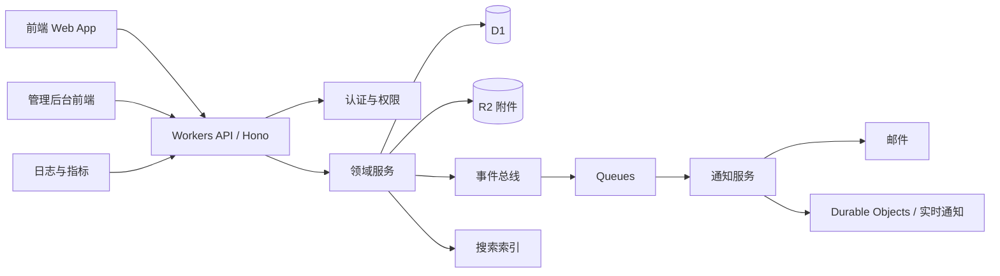
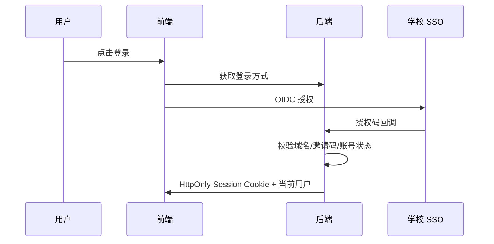

# 世外墙 WFLA Wall — 后端优先总体规划 v0.2

- 状态：v0.3.1 修订——反映 v0.3.1 已实现的能力（自托管、皮肤系统、用户偏好、独立管理后台）；继续作为目标与范围参考。
- 日期：2026-10-21
- 仓库：`WFLA-AI-Lab/WFLA_Forum_universal`
- 参考项目：`Computerization/WFLAwall`
- 主要交付方向：后端 API、数据模型、权限体系、通知/公告/监管/管理能力，并为前端提供稳定契约。

---

## 1. 执行摘要

世外墙 WFLA Wall 面向上海市世外中学，做一个**校园内可信、可监管、可扩展、功能完整**的论坛系统。它不应只是“匿名发帖墙”，而应成为一个校园社区基座：

- 学生可以安全发帖、评论、互动、搜索、收藏、关注感兴趣的内容。
- 社团、教师、学校官方可以发布公告、通知和活动信息。
- 管理员和监管者可以处理举报、审核内容、管理用户与板块，并有完整审计记录。
- 系统通过清晰的 API 契约、模块化领域模型、事件驱动能力和可配置权限，支撑未来扩展。
- 后端先行：先建立身份、权限、内容、通知、监管和管理这些“地基”，前端由另一位同学基于 API 契约并行开发。

建议采用**TypeScript + Hono + Cloudflare Workers + D1 + R2 + Queues + Durable Objects**的技术路线：与旧项目经验衔接、成本低、适合校园规模，并且能覆盖图片、附件、异步任务和实时通知。核心代码通过仓储接口和契约层保持一定可移植性，避免完全绑死。

---

## 2. 产品定位

### 2.1 一句话定位

> 世外墙 WFLA Wall 是一个面向世外中学成员的、以可信身份为基础、支持匿名展示和强监管的校园论坛与信息发布平台。

### 2.2 核心价值

1. **表达与交流**：学生可以围绕学习、社团、校园生活、兴趣等话题交流。
2. **信息可信**：官方公告、社团通知、课程/活动信息有明确发布主体和可见范围。
3. **安全与秩序**：举报、审核、封禁、警告、申诉、审计一整套闭环。
4. **长期可维护**：API 优先、清晰边界、完整文档、自动化测试。
5. **可扩展**：板块、标签、权限、通知类型、内容类型、统计报表均可扩展。

### 2.3 用户画像

| 用户 | 目标 | 关键需求 |
|---|---|---|
| 普通学生 | 看帖、发帖、评论、收藏、关注 | 易用、加载快、搜索好、通知及时 |
| 匿名倾向学生 | 匿名提问或表达 | 匿名展示、身份受控、反辱骂/人肉 |
| 社团成员/负责人 | 发布活动、管理社团话题 | 社团板块、公告、活动标签、权限 |
| 教师/职工 | 发布通知、了解学生反馈 | 官方身份、定向公告、置顶、统计 |
| 版主/监管者 | 处理举报和违规内容 | 举报队列、批量处理、警告、隐藏、审计 |
| 系统管理员 | 维护系统、配置规则、保障安全 | 权限管理、系统设置、日志、备份 |
| 前端开发者 | 快速开发界面 | OpenAPI、Mock 数据、稳定 API、联调环境 |
| 游客/未登录用户 | 了解论坛概况 | 可配置是否只读/完全不可见 |

---

## 3. 目标与非目标

### 3.1 必须达成

- 后端提供完整 REST API 和 OpenAPI 文档。
- 支持账号身份、角色、组、权限、状态管理。
- 支持板块、话题、帖子、评论、回复、附件、图片、标签。
- 支持公告、通知、站内信或消息中心。
- 支持举报、审核、处罚、申诉、审计。
- 支持搜索、收藏、点赞/表情反应、关注。
- 支持后台管理、系统设置、统计报表。
- 支持数据库迁移、回滚、备份、恢复演练。
- 支持开发、测试、预发布、生产环境。
- 具备安全边界：认证、授权、限流、防滥用、内容净化、审计。

### 3.2 暂不做或后置

- 不做完整即时聊天系统，后续可作为独立模块。
- 不做 ActivityPub/Federation 等去中心化协议。
- 不做商城、积分交易、虚拟货币。
- 不做复杂推荐算法；初期以时间、热度、关注、标签为主。
- 不做移动原生 App；先保证响应式 Web 和 API 能力。
- 不做动态上传插件运行；Cloudflare Workers 环境下更适合“内置扩展点 + 配置 + Webhook”。

---

## 4. 关键假设与待确认决策

以下为推荐默认值，需确认后进入实施。

| 决策点 | 推荐方案 | 影响 |
|---|---|---|
| 身份认证 | 学校 Google/Microsoft/OIDC SSO + 邮箱域限制 + 邀请码；可选 passkey | 安全性最高，避免弱密码；需学校账号体系 |
| 是否允许游客访问 | 默认不允许，仅登录后可见；可配置少量公开公告 | 保护校园隐私 |
| 匿名策略 | 匿名展示，但后端保留作者关联；仅高权限 + 双人/审计流程可揭示 | 平衡表达与监管 |
| 多校区/多租户 | 数据模型预留 `organization_id`，初期单校区 | 支撑“universal”方向，但避免初期复杂化 |
| 部署平台 | Cloudflare Workers + D1 + R2 | 与旧项目衔接，成本低 |
| 内容格式 | Markdown 子集 + 附件，服务端净化 | 降低 XSS 风险 |
| 搜索 | 初期 SQLite FTS/分词适配，后续可替换 Meilisearch/Typesense | 控制复杂度 |
| 通知渠道 | 站内 + 邮件；后续 Webhook/企业微信/钉钉 | 满足校园场景 |
| 最终监管权 | 学校教师/管理员 + 社团负责人分级 | 需明确责任人 |
| 数据保留 | 内容与审计日志分级保留，支持删除/注销 | 需符合隐私要求 |

---

## 5. 参考论坛功能调研

### 5.1 参考对象

- [Discourse](https://github.com/discourse/discourse)
- [Flarum](https://github.com/flarum/framework)
- [NodeBB](https://github.com/NodeBB/NodeBB)
- [phpBB](https://github.com/phpbb/phpbb)
- [MyBB](https://github.com/mybb/mybb)
- 旧项目 [WFLAwall](https://github.com/Computerization/WFLAwall)

### 5.2 功能借鉴矩阵

| 系统 | 值得借鉴 | 对 WFLA Wall 的启发 | 风险/不照搬原因 |
|---|---|---|---|
| Discourse | 话题/帖子模型、分类、标签、信任等级、插件、审核队列、通知、管理员统计 | 用信任等级控制新用户权限；用话题+帖子分层；插件化扩展点 | 功能庞大，初期不宜全套复制 |
| Flarum | Discussion/Post/Group/Permission/Notification、扩展系统、API 节流 | 权限策略层、通知驱动、API 限流、扩展生命周期 | PHP 生态，不直接迁移 |
| NodeBB | 分类权限、群组、话题工具、通知、举报、上传、插件、实时能力 | 分类权限矩阵、通知类型、举报状态机、话题合并/移动 | 功能复杂，先做核心 |
| phpBB | 传统版块、投票、附件、警告、审核队列、后台日志 | 版块结构、警告/处罚、后台审计 | 界面和模型较老 |
| MyBB | 公告、举报理由、警告、用户组晋升、计划任务、统计、备份 | 公告定向投放、举报理由配置、自动晋升、定时任务 | 同上 |
| 旧 WFLAwall | D1/R2/Hono 部署经验、用户/帖子/评论/点赞/收藏/关注基础 | 保留技术路线与基础概念 | 需重建认证、权限、公告、通知、监管、审计和完整数据模型 |

### 5.3 旧项目可复用与需重建点

可借鉴：

- Cloudflare Workers + D1 + R2 的部署思路。
- 用户、帖子、评论、点赞、收藏、关注、图片上传等基础概念。
- 管理员角色与封禁的初步思路。

需重建：

- 认证体系：不应使用硬编码 JWT secret 或自造未签名 token。
- 权限体系：应改为角色 + 组 + 板块级权限 + 策略层。
- 内容模型：从“restaurants/comments”式结构改为通用 thread/post 模型。
- 监管体系：新增举报理由、案件、审核队列、处罚、申诉、审计。
- 通知体系：新增事件驱动通知和用户偏好。
- 公告体系：新增定向、定时、置顶、确认阅读。
- 测试、迁移、OpenAPI、可观测性、备份恢复。

注意：旧仓库未看到明确开源许可证，建议**只借鉴设计，不直接复制代码**，除非获得授权。

---

## 6. 产品信息架构

建议初期结构：

1. 首页
   - 最新
   - 热门
   - 关注
   - 公告
   - 推荐标签
2. 板块
   - 校园生活
   - 学习交流
   - 社团组织
   - 兴趣圈子
   - 二手/失物/求助
   - 官方公告
3. 话题页
   - 主帖
   - 评论/楼层
   - 附件
   - 投票
   - 相关推荐
4. 个人中心
   - 我的帖子
   - 我的收藏
   - 我的关注
   - 通知
   - 设置
5. 管理后台
   - 用户
   - 板块
   - 内容
   - 举报
   - 公告
   - 权限
   - 设置
   - 审计
   - 统计

---

## 7. 核心功能规划

### 7.1 身份与账号

#### 必做

- 登录/登出/会话管理。
- 账号状态：active、restricted、muted、banned、deleted、pending。
- 用户资料：昵称、头像、简介、年级/班级/身份标签、展示权限。
- 身份绑定：学校账号、邮箱、passkey。
- 用户组：学生、教师、社团、管理员、版主。
- 匿名展示名：每个话题可选匿名代号。
- 账号注销与数据删除策略。
- 登录历史与会话撤销。

#### 建议

- 新注册用户进入观察期。
- 支持邀请码/白名单控制准入。
- 支持双因素/passkey。
- 支持账号申诉。

### 7.2 权限体系

采用：

- 全局角色：guest、member、student、teacher、moderator、admin、owner。
- 用户组：社团、年级、班级、兴趣组。
- 板块级权限：查看、发话题、回复、上传、投票、置顶、锁定、隐藏、删除。
- 策略层：对象级判断，例如“作者本人可编辑 15 分钟内内容”。
- 信任等级：new、basic、member、regular、leader。
- 审计：所有敏感权限操作写入不可篡改日志。

权限判断示例：

```text
can(user, "thread:create", board)
can(user, "post:edit", post)
can(user, "moderation:hide", post)
can(user, "announcement:publish", board)
```

### 7.3 板块、标签与分类

- 板块 CRUD、排序、启用/禁用。
- 板块类型：普通、公告、社团、问答、匿名墙。
- 板块权限覆盖全局默认。
- 标签管理：创建、合并、禁用、推荐。
- 必选/可选标签规则。
- 板块版主指定。
- 板块统计与健康指标。

### 7.4 发帖与评论

#### 话题 Thread

- 标题、正文、板块、标签、附件。
- 置顶、锁定、隐藏、恢复、移动、合并。
- 匿名/实名展示。
- 草稿、定时发布、编辑历史。
- 浏览量、回复量、最后回复时间。
- 投票/问答/活动等特殊类型。

#### 评论 Post

- 支持楼层、回复、引用。
- Markdown 子集：标题、列表、粗体、斜体、链接、代码块、引用、图片。
- 附件：图片、PDF、压缩包、文档。
- 表情反应。
- 编辑历史与差异。
- 软删除与恢复。
- 楼层合并/拆分/移动，后置到 v2。

### 7.5 公告与通知

#### 公告

- 发布者：学校官方、教师、社团。
- 受众：全校、年级、班级、社团、指定用户组。
- 定时发布和下线。
- 置顶、重要级别、颜色标识。
- 确认阅读/回执。
- 阅读统计。
- 紧急公告支持强提醒。

#### 通知

类型：

- 被回复。
- 被提及。
- 被点赞/反应。
- 关注话题有新回复。
- 公告发布。
- 举报状态变化。
- 内容被隐藏/恢复。
- 账号安全提醒。
- 系统维护通知。
- 每日/每周摘要。

渠道：

- 站内通知中心。
- 邮件。
- 后续 Webhook/企业微信/钉钉/飞书。
- 摘要邮件。

能力：

- 用户按通知类型设置偏好。
- 免打扰时间。
- 批量已读。
- 去重与合并。
- 通知保留期限。
- 后台任务异步投递。

### 7.6 搜索

初期：

- 搜索话题、帖子、用户、标签、公告。
- 关键词、板块、作者、时间、标签、状态过滤。
- 中文搜索适配：分词或 trigram 策略。
- 高亮摘要。
- 搜索权限过滤：不能搜到无权查看内容。

后续：

- 拼音/同义词。
- 热搜。
- 相关话题推荐。
- 外部搜索引擎适配。

### 7.7 互动与成长

- 点赞/表情反应。
- 收藏/书签。
- 关注用户、话题、板块、标签。
- 浏览记录与未读状态。
- 用户徽章。
- 信任等级。
- 新用户引导。
- 热度算法：回复数、反应数、时间衰减、举报惩罚。

### 7.8 监管与审核

#### 举报

- 举报帖子、评论、用户、私信内容。
- 预设理由：辱骂、人肉/隐私、色情、暴力、广告、谣言、抄袭、其他。
- 可附说明和证据。
- 重复举报合并。
- 举报人可见处理状态。
- 防滥用举报限流。

#### 审核队列

- 待处理、处理中、已解决、已驳回。
- 按严重程度、时间、板块、举报次数排序。
- 支持批量隐藏/恢复/驳回。
- 自动规则：
  - 敏感词。
  - 重复内容。
  - 新用户高频发帖。
  - 高链接密度。
  - 高举报阈值自动隐藏。
- AI 辅助分类可后置，并必须保留人工复核。

#### 处罚

- 隐藏内容。
- 锁定话题。
- 禁言。
- 警告。
- 限制上传。
- 临时封禁。
- 永久封禁。
- 降低信任等级。
- 申诉流程。

#### 审计

- 谁在何时对谁做了什么。
- 操作原因。
- 前后状态。
- 不可普通删除，设置保留期。
- 管理员查看敏感身份需二次授权并记录。

### 7.9 管理后台

- 用户管理：搜索、查看、禁言、封禁、重置会话、调整组。
- 内容管理：话题、帖子、评论、附件、搜索、隐藏、恢复。
- 板块与标签管理。
- 公告管理。
- 举报管理。
- 权限与角色管理。
- 系统设置：注册策略、匿名策略、上传限制、敏感词、限流。
- 审计日志。
- 统计看板：DAU、发帖量、举报量、处理时长、热门板块、异常账号。
- 数据备份与恢复。
- 功能开关。

### 7.10 前端契约支持

后端需提供：

- OpenAPI 3.1 文档。
- TypeScript 类型包。
- Mock server / fixture 数据。
- 分页、错误码、字段命名规范。
- 环境变量样例。
- Postman/Bruno 集合。
- API changelog。
- 联调环境与测试账号。

---

## 8. 推荐技术架构

### 8.1 技术选型

| 层 | 建议 | 理由 |
|---|---|---|
| 语言 | TypeScript | 前后端共享类型，适合团队协作 |
| API 框架 | Hono | 轻量，适合 Workers |
| 运行时 | Cloudflare Workers | 低成本、全球边缘、已有旧项目经验 |
| 数据库 | Cloudflare D1 / SQLite | 校园规模够用，事务清晰 |
| ORM/迁移 | Drizzle ORM + migration | SQL 可控，类型安全 |
| 对象存储 | Cloudflare R2 | 图片、附件 |
| 异步任务 | Cloudflare Queues + Cron | 通知、统计、清理 |
| 实时通知 | Durable Objects + WebSocket/SSE | 精准在线推送 |
| 缓存 | Workers Cache API / KV | 热点列表和公告 |
| 校验 | Zod | 请求校验与 OpenAPI 生成 |
| 测试 | Vitest + Miniflare | 本地 Workers 测试 |
| 文档 | OpenAPI + TypeDoc | 前后端契约 |
| 日志 | Workers Logs + Sentry | 排障与告警 |

### 8.2 架构图



### 8.3 模块划分

建议采用“模块化单体”，避免初期微服务复杂度。

```text
src/
  app.ts
  env.ts
  routes/
    health.routes.ts
    auth.routes.ts
    users.routes.ts
    boards.routes.ts
    threads.routes.ts
    posts.routes.ts
    announcements.routes.ts
    notifications.routes.ts
    reports.routes.ts
    admin.routes.ts
  modules/
    identity/
    access/
    content/
    engagement/
    notification/
    announcement/
    moderation/
    administration/
    search/
    storage/
  shared/
    errors/
    pagination/
    validation/
    events/
  db/
    schema.ts
    migrations/
  contracts/
    openapi.ts
```

### 8.4 扩展机制

1. **领域事件**：`thread.created`、`post.published`、`report.created`。
2. **扩展点**：
   - 内容发布前校验。
   - 通知发送前过滤。
   - 搜索索引写入。
   - 权限策略。
3. **功能开关**：按环境/组织启用功能。
4. **Webhook**：向外部系统投递事件。
5. **适配器**：存储、搜索、邮件、身份认证可替换。
6. **不采用动态插件加载**：避免运行时安全和供应链风险。

---

## 9. 数据模型规划

### 9.1 设计原则

- 所有业务表包含：`id`、`created_at`、`updated_at`、`deleted_at`。
- 使用 UUIDv7 或 snowflake ID，便于排序和分布式生成。
- 软删除为主，物理删除仅用于合规清理任务。
- 身份表与展示资料分离，便于匿名与隐私控制。
- 审计日志独立，不允许业务删除。
- 预留 `organization_id`，支撑多校区/多租户。

### 9.2 核心表

#### Identity

- `organizations`
- `users`
- `identities`
- `sessions`
- `groups`
- `group_members`
- `roles`
- `permissions`
- `role_permissions`
- `user_roles`
- `user_profiles`
- `user_settings`
- `user_stats`
- `trust_levels`

#### Content

- `boards`
- `board_permissions`
- `board_moderators`
- `tags`
- `thread_tags`
- `threads`
- `posts`
- `post_revisions`
- `attachments`
- `polls`
- `poll_options`
- `poll_votes`

#### Engagement

- `reactions`
- `bookmarks`
- `follows`
- `thread_reads`
- `view_events`

#### Notification

- `notifications`
- `notification_preferences`
- `notification_deliveries`
- `digest_jobs`

#### Announcement

- `announcements`
- `announcement_audiences`
- `announcement_acknowledgements`
- `announcement_reads`

#### Moderation

- `report_reasons`
- `reports`
- `moderation_cases`
- `moderation_actions`
- `moderation_notes`
- `sanctions`
- `appeals`

#### System

- `settings`
- `feature_flags`
- `audit_logs`
- `rate_limit_buckets`
- `search_index`
- `webhooks`
- `outbox_events`

### 9.3 关键字段草案

#### `threads`

- `id`
- `organization_id`
- `board_id`
- `author_user_id`
- `title`
- `slug`
- `summary`
- `status`: draft、published、hidden、locked、deleted
- `visibility`: public、members、group
- `is_pinned`
- `is_locked`
- `is_anonymous`
- `anonymous_alias`
- `published_at`
- `last_posted_at`
- `reply_count`
- `reaction_count`
- `view_count`
- `report_count`
- `hot_score`

#### `posts`

- `id`
- `thread_id`
- `parent_post_id`
- `author_user_id`
- `content_markdown`
- `content_html`
- `status`
- `is_anonymous`
- `anonymous_alias`
- `floor_number`
- `edited_at`
- `edit_count`
- `reaction_count`
- `report_count`

#### `reports`

- `id`
- `reporter_id`
- `target_type`
- `target_id`
- `reason_id`
- `details`
- `status`
- `severity`
- `assigned_moderator_id`
- `resolved_at`
- `resolution`

#### `audit_logs`

- `id`
- `actor_id`
- `actor_role`
- `action`
- `target_type`
- `target_id`
- `before_state`
- `after_state`
- `reason`
- `ip_hash`
- `user_agent`
- `created_at`

### 9.4 索引策略

必须覆盖：

- 板块内话题列表：`board_id + status + last_posted_at`。
- 话题内评论列表：`thread_id + status + floor_number`。
- 用户内容：`author_user_id + created_at`。
- 举报队列：`status + severity + created_at`。
- 通知：`recipient_id + created_at`。
- 关注：`follower_id`、`following_target`。
- 标签：`tag_id + thread_id`。
- 审计：`actor_id`、`target_id`、`created_at`。

---

## 10. API 设计规划

### 10.1 通用规范

- 基础路径：`/v1`
- JSON only。
- 时间使用 ISO 8601 UTC，前端本地化显示。
- ID 使用字符串。
- 分页使用 cursor，避免 offset 深翻页性能问题。
- 错误结构统一：

```json
{
  "error": {
    "code": "PERMISSION_DENIED",
    "message": "You cannot reply to this thread.",
    "request_id": "req_..."
  }
}
```

- 写操作支持 `Idempotency-Key`。
- 列表支持 `fields` 或固定摘要对象，避免过度加载。
- 响应支持 `ETag`。
- 所有敏感接口有限流。
- API 版本化，不破坏已发布契约。

### 10.2 核心端点草案

#### Health

- `GET /v1/health`
- `GET /v1/metrics` 管理员可用

#### Auth

- `GET /v1/auth/providers`
- `POST /v1/auth/session`
- `DELETE /v1/auth/session`
- `GET /v1/me`
- `PATCH /v1/me`
- `POST /v1/me/sessions/revoke`
- `POST /v1/me/passkeys`

#### Boards

- `GET /v1/boards`
- `POST /v1/boards`
- `GET /v1/boards/{boardId}`
- `PATCH /v1/boards/{boardId}`
- `PUT /v1/boards/{boardId}/permissions`
- `GET /v1/boards/{boardId}/tags`

#### Threads

- `GET /v1/threads`
- `POST /v1/threads`
- `GET /v1/threads/{threadId}`
- `PATCH /v1/threads/{threadId}`
- `DELETE /v1/threads/{threadId}`
- `POST /v1/threads/{threadId}/pin`
- `POST /v1/threads/{threadId}/lock`
- `POST /v1/threads/{threadId}/move`

#### Posts

- `GET /v1/threads/{threadId}/posts`
- `POST /v1/threads/{threadId}/posts`
- `PATCH /v1/posts/{postId}`
- `DELETE /v1/posts/{postId}`
- `GET /v1/posts/{postId}/revisions`

#### Attachments

- `POST /v1/uploads/direct`
- `POST /v1/uploads/presign`
- `GET /v1/attachments/{attachmentId}`

#### Engagement

- `PUT /v1/posts/{postId}/reactions/{type}`
- `DELETE /v1/posts/{postId}/reactions/{type}`
- `PUT /v1/threads/{threadId}/bookmark`
- `DELETE /v1/threads/{threadId}/bookmark`
- `PUT /v1/follows`
- `DELETE /v1/follows/{followId}`
- `POST /v1/threads/{threadId}/read`

#### Announcements

- `GET /v1/announcements`
- `POST /v1/announcements`
- `GET /v1/announcements/{announcementId}`
- `PATCH /v1/announcements/{announcementId}`
- `DELETE /v1/announcements/{announcementId}`
- `POST /v1/announcements/{announcementId}/acknowledge`

#### Notifications

- `GET /v1/notifications`
- `POST /v1/notifications/read-all`
- `PATCH /v1/notifications/{notificationId}/read`
- `GET /v1/notification-preferences`
- `PUT /v1/notification-preferences`

#### Reports

- `POST /v1/reports`
- `GET /v1/reports`
- `GET /v1/reports/{reportId}`
- `POST /v1/reports/{reportId}/assign`
- `POST /v1/reports/{reportId}/resolve`
- `POST /v1/reports/{reportId}/reject`

#### Moderation

- `GET /v1/moderation/queue`
- `GET /v1/moderation/cases/{caseId}`
- `POST /v1/moderation/cases/{caseId}/actions`
- `POST /v1/sanctions`
- `POST /v1/appeals`

#### Admin

- `GET /v1/admin/users`
- `GET /v1/admin/stats`
- `GET /v1/admin/audit-logs`
- `GET /v1/admin/settings`
- `PUT /v1/admin/settings`
- `POST /v1/admin/backups`
- `GET /v1/admin/backups`

---

## 11. 核心流程

### 11.1 登录



### 11.2 发帖

1. 前端提交标题、正文、标签、附件、匿名选项。
2. 后端校验权限、输入、限流、敏感词。
3. 生成 thread + first post。
4. 保存附件关联。
5. 写搜索索引。
6. 发布领域事件。
7. 通知关注者/提及者。
8. 返回完整资源或摘要。

### 11.3 举报处理

1. 用户提交举报。
2. 后端去重、计算严重度。
3. 达到阈值则自动隐藏或标记高风险。
4. 进入审核队列。
5. 版主查看上下文、历史、作者记录。
6. 执行隐藏/警告/封禁/驳回。
7. 写入审计日志。
8. 通知举报人、作者、版主。

### 11.4 公告发布

1. 官方账号创建公告。
2. 选择受众、时间、重要级别。
3. 定时任务到点发布。
4. 生成通知。
5. 记录阅读和确认。
6. 管理员查看触达率。

---

## 12. 安全、隐私与合规

### 12.1 认证安全

- 推荐 OIDC/SSO，限制学校邮箱域。
- Session 使用 HttpOnly + Secure + SameSite cookie。
- 服务端 session 表，可撤销。
- 登录失败限流。
- 可选 passkey/2FA。
- 不在前端保存长期 token。
- CSRF 双提交或 SameSite 严格策略。

### 12.2 授权安全

- 每个接口显式声明所需权限。
- 权限判断集中在一个 `AccessControl` 模块。
- 板块、内容、用户对象逐级判断。
- 默认拒绝。
- 管理操作要求原因。
- 高危操作二次确认。
- 不得信任前端传来的 role/status。

### 12.3 内容安全

- Markdown 白名单渲染。
- 链接协议白名单。
- CSP 响应头。
- 上传 MIME/魔数/扩展校验。
- 图片重新编码、剥离 EXIF。
- 文件大小和频率限制。
- 附件扫描策略。
- 敏感词和自动审核规则。
- 防 XSS、CSRF、SSRF、点击劫持。

### 12.4 防滥用

- Turnstile 或等效人机校验。
- 新用户发帖延迟和限额。
- 同 IP/设备/账号多维限流。
- 重复内容检测。
- 链接密度检测。
- 举报限流，防止恶意举报。
- 异常行为告警。

### 12.5 隐私

- 匿名展示与真实身份分离。
- 管理员揭示身份必须记录审计。
- 最小化收集：不强制收集手机号等非必要信息。
- 支持账号注销。
- 数据导出。
- 数据分级保留。
- 备份加密。
- IP 哈希或短保留。
- 审计日志限制访问。
- 满足未成年人数据处理要求。

### 12.6 威胁模型

| 威胁 | 缓解 |
|---|---|
| 冒充学生 | SSO + 域名限制 + 邀请码 |
| 匿名辱骂 | 举报、自动隐藏、禁言、审计 |
| 人肉搜索 | 隐私词过滤、举报优先级、快速下架 |
| XSS | 服务端净化、CSP、测试 |
| 权限提升 | 集中授权、默认拒绝、审计 |
| 上传恶意文件 | 类型校验、重编码、隔离域名 |
| 刷帖/爬虫 | 限流、Turnstile、异常检测 |
| 数据泄露 | 最小权限、备份加密、访问审计 |
| 管理员滥用 | 审计、双人流程、告警 |

---

## 13. 性能与可靠性目标

校园规模预估：

- 注册用户：1,000–5,000。
- 日活：300–1,500。
- 日发帖：500–5,000。
- 附件：每天数百到数千。

SLO：

- 列表 API p95 < 300ms。
- 详情 API p95 < 300ms。
- 上传完成 p95 < 2s。
- 通知投递 p95 < 5s。
- 可用性目标：99.5%。
- 举报首次响应：上课时间 < 10min。
- 严重违规下架：< 5min。

策略：

- 热点列表缓存。
- Cursor 分页。
- 附件走 R2/CDN。
- 通知异步化。
- 统计任务错峰。
- 读写索引优化。
- 定期备份和恢复演练。
- 关键接口压测。
- 数据库迁移先在预发布执行。

---

## 14. 可观测性

- 结构化日志：`request_id`、`user_id`、`route`、`status`、耗时。
- Sentry 错误上报。
- 管理端健康页：DB、R2、Queue、邮件、搜索。
- 业务指标：
  - DAU/WAU。
  - 发帖/评论数。
  - 举报量。
  - 平均处理时长。
  - 通知失败率。
  - API 错误率。
  - 上传失败率。
- 告警：
  - 5xx 突增。
  - 数据库错误。
  - 队列积压。
  - 举报积压。
  - 登录异常。
  - 备份失败。

---

## 15. 测试计划

### 15.1 测试层级

- 单元测试：权限、限流、状态机、热度算法、净化。
- 集成测试：API + D1 + R2 mock。
- 契约测试：OpenAPI 与实际响应一致。
- E2E API 测试：完整用户旅程。
- 迁移测试：旧库 -> 新库。
- 性能测试：列表、详情、发帖、通知。
- 安全测试：越权、XSS、CSRF、上传、枚举、限流。

### 15.2 覆盖率要求

- 领域逻辑 ≥ 80%。
- 权限模块 ≥ 95%。
- 关键路径 100% 场景覆盖。
- 每个 API 至少有成功、未登录、无权限、参数错误四类测试。

### 15.3 必测场景

1. 未登录不能读取私有板块。
2. 普通用户不能隐藏他人帖子。
3. 版主只能管理被授权板块。
4. 被禁言用户不能发帖但能浏览。
5. 匿名帖子返回中不包含真实用户 ID。
6. 举报达到阈值自动隐藏。
7. 审计日志记录管理员操作。
8. 附件上传后不能被执行。
9. 通知偏好关闭后不发送邮件。
10. 删除账号后个人数据按策略处理。

---

## 16. 后端实施路线图

### Phase 0 — 决策与契约冻结

时间：1 周。

交付：

- 确认认证方式、匿名策略、公开性、监管责任人。
- 冻结 v1 API 范围。
- 建立仓库规范、分支规范、CI。
- 输出 OpenAPI 初稿。
- 输出数据库 ERD 初稿。

验收：

- 前端可基于 OpenAPI 开始搭建页面骨架。
- 所有核心决策有明确负责人。

### Phase 1 — 工程地基

时间：1–2 周。

交付：

- TypeScript + Hono + Workers 项目骨架。
- CI/CD。
- D1 migration 框架。
- 环境变量与密钥管理。
- 请求日志、错误模型、分页、Zod 校验。
- `/health`。
- OpenAPI 生成。

验收：

- 本地一条命令启动。
- CI 全绿。
- API 文档可访问。

### Phase 2 — 身份与权限

时间：1–2 周。

交付：

- SSO/session/me。
- 用户、组、角色、权限表。
- AccessControl 中间件。
- 用户状态和会话撤销。
- 基础管理接口。

验收：

- 未登录、普通用户、版主、管理员行为符合权限矩阵。
- 安全测试通过。

### Phase 3 — 内容核心

时间：2–3 周。

交付：

- 板块、标签、话题、帖子。
- Markdown 渲染与净化。
- 附件上传。
- 编辑历史。
- 软删除/恢复。
- 基础搜索。

验收：

- 前端可完成首页、板块页、话题页、发帖页。
- 核心内容 API 稳定。

### Phase 4 — 通知与公告

时间：1–2 周。

交付：

- 通知中心。
- 通知偏好。
- 邮件投递。
- 公告创建、定向、定时、置顶、确认。
- 异步队列。

验收：

- 回复、提及、公告通知可稳定送达。
- 公告触达统计可用。

### Phase 5 — 监管与管理后台

时间：2–3 周。

交付：

- 举报理由和举报流。
- 审核队列。
- 处罚与申诉。
- 审计日志。
- 用户管理、板块管理、设置管理。
- 统计看板。

验收：

- 一条举报从提交到处理到通知全链路闭环。
- 所有敏感操作可追踪。

### Phase 6 — 互动与体验增强

时间：1–2 周。

交付：

- 反应、收藏、关注、未读。
- 热度排序。
- 信任等级。
- 徽章。
- 搜索优化。

验收：

- 首页“最新/热门/关注”可用。
- 用户成长体系可用。

### Phase 7 — 上线前加固

时间：1 周。

交付：

- 压测。
- 安全扫描。
- 备份恢复演练。
- 管理员手册。
- 应急预案。
- 公告与用户协议。
- 灰度上线。

验收：

- SLO 达标。
- 无高危漏洞。
- 管理员可独立处理常见问题。

---

## 17. 里程碑与前端协作

| 里程碑 | 后端交付 | 前端可开发内容 |
|---|---|---|
| M1 | OpenAPI + Mock | 登录、布局、路由 |
| M2 | Auth + Me | 登录态、个人中心 |
| M3 | Boards + Threads | 首页、板块、话题列表 |
| M4 | Posts + Uploads | 话题详情、发帖、评论 |
| M5 | Notifications + Announcements | 通知中心、公告栏 |
| M6 | Reports + Admin | 举报入口、管理后台 |
| M7 | Engagement + Search | 收藏、关注、搜索、热度 |

---

## 18. 仓库与工程规范建议

```text
/
  backend/
    src/
    db/
    tests/
    wrangler.toml
  frontend/
  packages/
    contracts/
  docs/
    PROJECT_PLAN.md
    api/
    architecture/
    runbooks/
  .github/
    workflows/
```

规范：

- 分支：`main` 保护，功能分支 `feat/...`。
- Commit：Conventional Commits。
- PR：必须关联 issue，至少一人 review。
- CI：lint、typecheck、test、migration check、OpenAPI check。
- 发布：semantic version。
- 密钥：只放 Cloudflare Secrets，不入仓库。
- 文档：每个模块有 `README.md`。
- API 变更必须有 changelog。

---

## 19. 风险与应对

| 风险 | 等级 | 应对 |
|---|---|---|
| 认证体系不确定 | 高 | Phase 0 必须确认；先实现适配器接口 |
| 匿名与监管冲突 | 高 | 明确匿名策略和揭示身份流程 |
| 未成年人隐私合规 | 高 | 数据最小化、审计、保留策略 |
| 管理人力不足 | 高 | 自动规则、批量处理、举报 SLA |
| 功能范围过大 | 高 | 严格按 MoSCoW 分阶段 |
| D1 复杂查询性能 | 中 | 索引设计、缓存、必要时外置搜索 |
| Cloudflare 供应商绑定 | 中 | 领域层和仓储接口保持可移植 |
| 前后端契约漂移 | 中 | OpenAPI + contract test |
| 上传滥用 | 中 | 限流、类型校验、重编码 |
| 备份不可恢复 | 高 | 定期恢复演练 |

---

## 20. v1 上线检查清单

### 产品

- [ ] 登录/登出可用。
- [ ] 首页/板块/话题/发帖/评论可用。
- [ ] 搜索可用。
- [ ] 通知可用。
- [ ] 公告可用。
- [ ] 举报可用。
- [ ] 管理后台可用。

### 安全

- [ ] 权限矩阵测试通过。
- [ ] XSS/CSRF 测试通过。
- [ ] 上传安全测试通过。
- [ ] 限流生效。
- [ ] 审计日志完整。
- [ ] Secrets 不在仓库。

### 运维

- [ ] CI/CD 可用。
- [ ] 备份自动执行。
- [ ] 恢复演练通过。
- [ ] 告警接入。
- [ ] 管理员 runbook 完成。

### 文档

- [ ] OpenAPI 完成。
- [ ] 部署文档完成。
- [ ] 管理员手册完成。
- [ ] 用户协议和隐私说明完成。
- [ ] 应急联系方式明确。

---

## 21. 待用户确认的问题

1. 学校是否有可用的 Google/Microsoft/OIDC SSO？如果没有，是否接受邀请码 + 邮箱验证？
2. 论坛是否完全私有？游客是否可以看任何内容？
3. 匿名帖子是否允许？管理员在什么条件下可以揭示真实身份？
4. 谁是最终监管负责人？教师、社团负责人、还是学校行政部门？
5. 是否需要支持教师/官方身份的特殊标识？
6. 是否需要多校区或多租户，还是仅世外中学单校区？
7. 附件是否允许非图片文件？最大尺寸和格式限制？
8. 数据保留多久？注销账号后内容如何处理？
9. 是否需要邮件通知？学校是否提供邮件服务？
10. 部署域名、Cloudflare 账号和生产环境由谁管理？
11. 是否需要对接学校现有系统，如社团管理系统或班级名单？
12. v1 上线时间目标是什么？

---

## 22. 参考资料

- Discourse:
  - [README](https://github.com/discourse/discourse/blob/main/README.md)
  - [Trust Level](https://github.com/discourse/discourse/blob/main/lib/trust_level.rb)
  - [Trust Level 3 Requirements](https://github.com/discourse/discourse/blob/main/app/models/trust_level3_requirements.rb)
- Flarum:
  - [Repository](https://github.com/flarum/framework)
  - Core source modules: `framework/core/src/{Api,Discussion,Post,Notification,User,Group,Settings,Queue}`
- NodeBB:
  - [Repository](https://github.com/NodeBB/NodeBB)
  - [Category privileges](https://github.com/NodeBB/NodeBB/blob/master/src/privileges/categories.js)
  - [Notifications](https://github.com/NodeBB/NodeBB/blob/master/src/notifications.js)
  - [Flags](https://github.com/NodeBB/NodeBB/blob/master/src/flags.js)
- phpBB:
  - [Repository](https://github.com/phpbb/phpbb)
- MyBB:
  - [Repository](https://github.com/mybb/mybb)
  - Admin modules: announcements, report reasons, warnings, groups, tasks, backups
- 旧项目：
  - [WFLAwall](https://github.com/Computerization/WFLAwall)
  - [backend/src/index.ts](https://github.com/Computerization/WFLAwall/blob/main/backend/src/index.ts)
  - [backend/schema.sql](https://github.com/Computerization/WFLAwall/blob/main/backend/schema.sql)

---

## 23. 结论

建议 WFLA Wall 的建设顺序是：

1. 先确定身份、匿名、监管和部署决策。
2. 建立后端工程地基和 API 契约。
3. 完成身份与权限。
4. 完成内容核心。
5. 完成通知与公告。
6. 完成监管与管理。
7. 最后增强互动和搜索。

这样才能避免“先做一个简单发帖墙，之后再补安全和监管”的常见陷阱。对于校园社区来说，**可信身份、清晰权限、完整监管和可恢复的数据**比界面炫技更重要。
